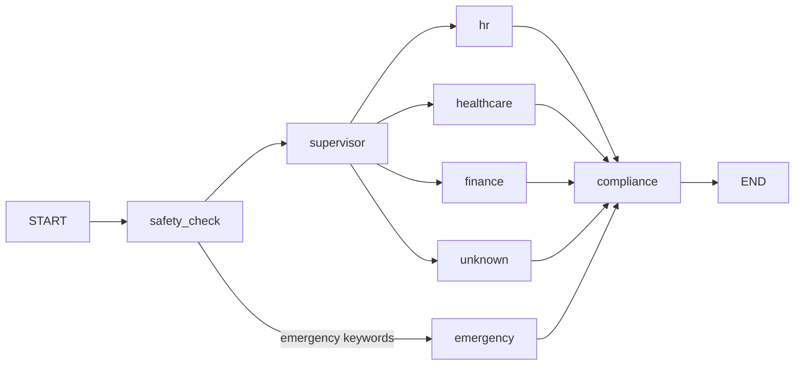

# 04 · Vertical Assistants: HR, Healthcare, Finance

One chat interface, three domain-specific assistants. A supervisor routes every message to the right domain agent; each agent has its own tools, prompt and rules. Safety and compliance are handled by dedicated graph nodes, not left to the LLM.

| Domain | Tools | Domain rules |
|--------|-------|--------------|
| **HR** (Acme Corp) | `get_employee`, `search_hr_policy`, `request_leave`, `my_leave_requests` | Leave checks balance, pending requests, working days and the 3-day-notice rule in code |
| **Healthcare** (CityCare Clinic) | `find_doctors`, `check_availability`, `book_appointment`, `my_appointments`, `cancel_appointment` | No diagnosis; emergency messages bypass the LLM; double-booking blocked by a unique index |
| **Finance** (ShopEase Pay) | `get_account_summary`, `recent_transactions`, `spending_by_category` | Read-only; every call verifies account number + owner email; no investment advice |

## Database setup (Supabase)

1. Open your project in the [Supabase Dashboard](https://supabase.com/dashboard) → **SQL Editor** → **New query**.
2. Paste the SQL from each step below, in order, and click **Run**. "Success. No rows returned" means it worked.
3. Run the verify query at the end.

All statements are idempotent (`if not exists`, `on conflict do nothing`), so running them twice never duplicates data. The same SQL is part of [`supabase/schema.sql`](../supabase/schema.sql), which sets up **all six modules at once**; if you have already run that, skip this section.

**Step 1: shared tables** (`customers`, `products`, `orders`). Skip if you already created them for another module; re-running is harmless.

<details>
<summary>Show SQL: shared tables + sample data</summary>

```sql
create table if not exists customers (
    id bigint generated by default as identity primary key,
    name text not null,
    city text not null,
    email text
);
alter table customers add column if not exists plan text not null default 'basic';
alter table customers add column if not exists created_at timestamptz not null default now();
create unique index if not exists customers_email_key on customers (email);

insert into customers (name, city, email, plan) values
    ('Rahul',  'Delhi',     'rahul@example.com',  'premium'),
    ('Priya',  'Mumbai',    'priya@example.com',  'basic'),
    ('Amit',   'Pune',      'amit@example.com',   'basic'),
    ('Sneha',  'Bengaluru', 'sneha@example.com',  'premium'),
    ('Vikram', 'Chennai',   'vikram@example.com', 'enterprise'),
    ('Ananya', 'Hyderabad', 'ananya@example.com', 'basic'),
    ('Karan',  'Delhi',     'karan@example.com',  'premium'),
    ('Meera',  'Kolkata',   'meera@example.com',  'basic')
on conflict (email) do update set plan = excluded.plan;

create table if not exists products (
    id bigint generated by default as identity primary key,
    sku text not null unique,
    name text not null,
    category text not null,
    price numeric(10, 2) not null
);

insert into products (sku, name, category, price) values
    ('SW-X1',    'SmartWatch X1',               'Wearables',   4999),
    ('EB-PRO',   'Wireless Earbuds Pro',        'Audio',       2999),
    ('SPK-MINI', 'Bluetooth Speaker Mini',      'Audio',       1999),
    ('LS-STD',   'Laptop Stand',                'Accessories', 1499),
    ('HUB-7',    'USB-C Hub 7-in-1',            'Accessories', 2499),
    ('NC-HP',    'Noise Cancelling Headphones', 'Audio',       8999),
    ('FB-LITE',  'Fitness Band Lite',           'Wearables',   1799),
    ('KB-MECH',  'Mechanical Keyboard',         'Accessories', 3999)
on conflict (sku) do nothing;

create table if not exists orders (
    id bigint generated by default as identity primary key,
    order_number text not null unique,
    customer_id bigint not null references customers (id),
    product_id bigint not null references products (id),
    quantity int not null check (quantity > 0),
    total numeric(10, 2) not null,
    status text not null check (status in ('placed', 'shipped', 'delivered', 'cancelled', 'returned')),
    order_date date not null
);

-- Orders are inserted by email / SKU so the ids resolve correctly in any database.
insert into orders (order_number, customer_id, product_id, quantity, total, status, order_date)
select v.order_number, c.id, p.id, v.qty, p.price * v.qty, v.status, v.order_date::date
from (values
    ('ORD-1001', 'rahul@example.com',  'SW-X1',    1, 'delivered', '2026-08-02'),
    ('ORD-1002', 'priya@example.com',  'EB-PRO',   1, 'delivered', '2026-09-28'),
    ('ORD-1003', 'amit@example.com',   'HUB-7',    2, 'delivered', '2026-08-15'),
    ('ORD-1004', 'sneha@example.com',  'NC-HP',    1, 'delivered', '2026-09-05'),
    ('ORD-1005', 'amit@example.com',   'KB-MECH',  1, 'delivered', '2026-10-01'),
    ('ORD-1006', 'vikram@example.com', 'LS-STD',   5, 'delivered', '2026-08-20'),
    ('ORD-1007', 'ananya@example.com', 'FB-LITE',  1, 'cancelled', '2026-09-12'),
    ('ORD-1008', 'karan@example.com',  'SPK-MINI', 2, 'delivered', '2026-09-18'),
    ('ORD-1009', 'rahul@example.com',  'NC-HP',    1, 'shipped',   '2026-10-14'),
    ('ORD-1010', 'meera@example.com',  'EB-PRO',   1, 'delivered', '2026-08-25'),
    ('ORD-1011', 'vikram@example.com', 'SW-X1',    3, 'placed',    '2026-10-18'),
    ('ORD-1012', 'meera@example.com',  'NC-HP',    1, 'delivered', '2026-10-06'),
    ('ORD-1013', 'sneha@example.com',  'FB-LITE',  2, 'returned',  '2026-08-10'),
    ('ORD-1014', 'karan@example.com',  'KB-MECH',  1, 'shipped',   '2026-10-16'),
    ('ORD-1015', 'priya@example.com',  'SPK-MINI', 1, 'placed',    '2026-10-19')
) as v (order_number, email, sku, qty, status, order_date)
join customers c on c.email = v.email
join products p on p.sku = v.sku
on conflict (order_number) do nothing;

alter table customers enable row level security;
alter table products  enable row level security;
alter table orders    enable row level security;
```

</details>

**Step 2: HR, Healthcare and Finance tables** with sample employees, policies, doctors, bank accounts and transactions.

```sql
-- ---------- HR ----------
create table if not exists hr_employees (
    id bigint generated by default as identity primary key,
    emp_code text not null unique,
    name text not null,
    email text not null,
    department text not null,
    role text not null,
    manager text,
    join_date date not null,
    leave_balance int not null default 18
);

insert into hr_employees (emp_code, name, email, department, role, manager, join_date, leave_balance) values
    ('E101', 'Aarav Shah',    'aarav@acme.example', 'Engineering', 'Software Engineer',    'Neha Kapoor', '2023-04-10', 14),
    ('E102', 'Neha Kapoor',   'neha@acme.example',  'Engineering', 'Engineering Manager',  'Isha Verma',  '2020-01-15', 20),
    ('E103', 'Rohan Gupta',   'rohan@acme.example', 'Sales',       'Account Executive',    'Isha Verma',  '2024-07-01', 9),
    ('E104', 'Isha Verma',    'isha@acme.example',  'HR',          'HR Business Partner',  null,          '2021-11-20', 16),
    ('E105', 'Dev Malhotra',  'dev@acme.example',   'Finance',     'Financial Analyst',    'Isha Verma',  '2025-02-03', 18)
on conflict (emp_code) do nothing;

create table if not exists hr_leave_requests (
    id bigint generated by default as identity primary key,
    emp_code text not null references hr_employees (emp_code),
    start_date date not null,
    end_date date not null,
    days int not null,
    reason text,
    status text not null default 'pending' check (status in ('pending', 'approved', 'rejected')),
    created_at timestamptz not null default now()
);

create table if not exists hr_policies (
    id bigint generated by default as identity primary key,
    title text not null unique,
    content text not null,
    fts tsvector generated always as (to_tsvector('english', title || ' ' || content)) stored
);
create index if not exists hr_policies_fts_idx on hr_policies using gin (fts);

insert into hr_policies (title, content) values
    ('Annual Leave Policy',
     'Employees get 18 days of paid annual leave per calendar year, accrued at 1.5 days per month. Up to 5 unused days carry forward to the next year. Leave of more than 2 days must be requested at least 3 working days in advance and approved by the reporting manager. Weekends and public holidays are not counted as leave days.'),
    ('Sick Leave Policy',
     'Employees get 10 days of paid sick leave per year, separate from annual leave. Sick leave of more than 2 consecutive days requires a medical certificate. Unused sick leave does not carry forward.'),
    ('Work From Home Policy',
     'Employees may work from home up to 2 days per week with manager approval. Core collaboration hours are 11am to 4pm IST. Fully remote arrangements need HR and department head approval.'),
    ('Expense Reimbursement Policy',
     'Submit business expenses within 30 days with receipts for any item above Rs 500. Domestic travel is economy class; international flights over 6 hours may be premium economy. Reimbursements are paid with the next monthly salary.'),
    ('Parental Leave Policy',
     'Birthing parents receive 26 weeks of paid maternity leave. Non-birthing parents receive 2 weeks of paid paternity leave, usable within 6 months of the birth or adoption.'),
    ('Notice Period Policy',
     'The notice period is 60 days for individual contributors and 90 days for managers. Unused annual leave may be adjusted against the notice period with manager approval.')
on conflict (title) do nothing;

create or replace function search_hr_policies(q text, k int default 2)
returns table (id bigint, title text, content text, rank real)
language sql stable as $$
    select p.id, p.title, p.content, ts_rank(p.fts, query) as rank
    from hr_policies p, websearch_to_tsquery('english', regexp_replace(trim(q), '\s+', ' or ', 'g')) query
    where p.fts @@ query
    order by rank desc
    limit k;
$$;

-- ---------- Healthcare ----------
create table if not exists hc_doctors (
    id bigint generated by default as identity primary key,
    name text not null unique,
    specialty text not null,
    available_days text[] not null,
    slots text[] not null
);

insert into hc_doctors (name, specialty, available_days, slots) values
    ('Dr. Ananya Rao',   'General Physician', '{Mon,Tue,Wed,Thu,Fri}', '{09:00,10:00,11:00,14:00,15:00}'),
    ('Dr. Karthik Iyer', 'Cardiologist',      '{Mon,Wed,Fri}',         '{10:00,11:00,16:00}'),
    ('Dr. Sara Thomas',  'Dermatologist',     '{Tue,Thu,Sat}',         '{09:30,11:30,15:30}'),
    ('Dr. Mohan Das',    'Orthopedic',        '{Mon,Tue,Thu}',         '{10:00,12:00,17:00}'),
    ('Dr. Leela Menon',  'Pediatrician',      '{Wed,Thu,Fri,Sat}',     '{09:00,10:30,12:00}')
on conflict (name) do nothing;

create table if not exists hc_appointments (
    id bigint generated by default as identity primary key,
    patient_name text not null,
    patient_email text not null,
    doctor_id bigint not null references hc_doctors (id),
    appointment_date date not null,
    appointment_time text not null,
    reason text,
    status text not null default 'booked' check (status in ('booked', 'cancelled', 'completed')),
    created_at timestamptz not null default now()
);
create unique index if not exists hc_appointments_slot_key
    on hc_appointments (doctor_id, appointment_date, appointment_time) where status = 'booked';

-- ---------- Finance ----------
create table if not exists fin_accounts (
    id bigint generated by default as identity primary key,
    account_number text not null unique,
    customer_id bigint not null references customers (id),
    account_type text not null check (account_type in ('savings', 'current', 'credit_card')),
    balance numeric(12, 2) not null
);

insert into fin_accounts (account_number, customer_id, account_type, balance)
select v.account_number, c.id, v.account_type, v.balance
from (values
    ('ACC-5001', 'rahul@example.com',  'savings',     125000.00),
    ('ACC-5002', 'rahul@example.com',  'credit_card', -18500.00),
    ('ACC-5003', 'priya@example.com',  'savings',      64000.00),
    ('ACC-5004', 'vikram@example.com', 'current',     890000.00)
) as v (account_number, email, account_type, balance)
join customers c on c.email = v.email
on conflict (account_number) do nothing;

create table if not exists fin_transactions (
    id bigint generated by default as identity primary key,
    account_number text not null references fin_accounts (account_number),
    txn_date date not null,
    description text not null,
    category text not null,
    amount numeric(12, 2) not null   -- negative = money out, positive = money in
);

insert into fin_transactions (account_number, txn_date, description, category, amount)
select * from (values
    ('ACC-5001', '2026-08-01'::date, 'Salary - Acme Corp',      'income',     95000.00),
    ('ACC-5001', '2026-08-03'::date, 'Rent - August',           'housing',   -28000.00),
    ('ACC-5001', '2026-08-09'::date, 'BigBasket groceries',     'groceries',  -4200.00),
    ('ACC-5001', '2026-08-15'::date, 'Electricity bill',        'utilities',  -2100.00),
    ('ACC-5001', '2026-08-22'::date, 'Dinner - Olive Bistro',   'dining',     -3600.00),
    ('ACC-5001', '2026-09-01'::date, 'Salary - Acme Corp',      'income',     95000.00),
    ('ACC-5001', '2026-09-03'::date, 'Rent - September',        'housing',   -28000.00),
    ('ACC-5001', '2026-09-11'::date, 'BigBasket groceries',     'groceries',  -5100.00),
    ('ACC-5001', '2026-09-14'::date, 'Flight DEL-BOM',          'travel',     -9800.00),
    ('ACC-5001', '2026-09-20'::date, 'Swiggy',                  'dining',     -1450.00),
    ('ACC-5001', '2026-10-01'::date, 'Salary - Acme Corp',      'income',     95000.00),
    ('ACC-5001', '2026-10-03'::date, 'Rent - October',          'housing',   -28000.00),
    ('ACC-5001', '2026-10-08'::date, 'BigBasket groceries',     'groceries',  -4800.00),
    ('ACC-5001', '2026-10-12'::date, 'Mutual fund SIP',         'investment',-15000.00),
    ('ACC-5001', '2026-10-16'::date, 'Electricity bill',        'utilities',  -2350.00),
    ('ACC-5002', '2026-10-05'::date, 'Amazon - electronics',    'shopping',  -12500.00),
    ('ACC-5002', '2026-10-11'::date, 'Fuel - Indian Oil',       'transport',  -3000.00),
    ('ACC-5002', '2026-10-15'::date, 'Restaurant - Spice Route','dining',     -3000.00),
    ('ACC-5003', '2026-10-01'::date, 'Salary - Globex',         'income',     72000.00),
    ('ACC-5003', '2026-10-04'::date, 'Rent - October',          'housing',   -22000.00),
    ('ACC-5003', '2026-10-10'::date, 'Myntra',                  'shopping',   -6400.00),
    ('ACC-5003', '2026-10-13'::date, 'Gym membership',          'health',     -2500.00)
) as v (account_number, txn_date, description, category, amount)
where not exists (select 1 from fin_transactions);

alter table hr_employees      enable row level security;
alter table hr_leave_requests enable row level security;
alter table hr_policies       enable row level security;
alter table hc_doctors        enable row level security;
alter table hc_appointments   enable row level security;
alter table fin_accounts      enable row level security;
alter table fin_transactions  enable row level security;
```

**Verify:** run this query; you should see `hr_employees` 5, `hr_policies` 6, `hc_doctors` 5, `fin_accounts` 4, `fin_transactions` 22.

```sql
select 'hr_employees' as table_name, count(*) as row_count from hr_employees
union all select 'hr_policies' as table_name, count(*) as row_count from hr_policies
union all select 'hc_doctors' as table_name, count(*) as row_count from hc_doctors
union all select 'fin_accounts' as table_name, count(*) as row_count from fin_accounts
union all select 'fin_transactions' as table_name, count(*) as row_count from fin_transactions;
```

<!-- supabase-snapshot:start -->

### See it in Supabase

After running the SQL above:

1. **Create:** left sidebar → **SQL Editor** (`>_` icon) → **New query** → paste the SQL → **Run** (or Ctrl+Enter).
2. **Check:** left sidebar → **Database** → **Tables**, schema **public**. You should see this module's tables: `hr_employees`, `hr_leave_requests`, `hr_policies`, `hc_doctors`, `hc_appointments`, `fin_accounts`, `fin_transactions`.
3. **Browse data:** click a table (or open **Table Editor**, the grid icon) to see its rows; **View columns** lists the column types.

> The dashboard shows rows because you are logged in as the project owner. Row Level Security still blocks the public (anon) key.


<sub>Tables `chat_messages` … `fin_accounts`</sub>


<sub>Tables `fin_accounts` … `orders`</sub>

### Table snapshot

Generated from the live database with `python supabase/snapshot_readmes.py`.

#### `hr_employees` · 5 rows

| Column | Type | Notes |
|--------|------|-------|
| `id` | bigint | PK, auto id |
| `emp_code` | text | unique, required |
| `name` | text | required |
| `email` | text | required |
| `department` | text | required |
| `role` | text | required |
| `manager` | text |  |
| `join_date` | date | required |
| `leave_balance` | integer | default `18`, required |

Sample rows:

| emp_code | name | department | role | leave_balance |
|---|---|---|---|---|
| E101 | Aarav Shah | Engineering | Software Engineer | 14 |
| E102 | Neha Kapoor | Engineering | Engineering Manager | 20 |
| E103 | Rohan Gupta | Sales | Account Executive | 9 |

#### `hr_leave_requests` · 0 rows

| Column | Type | Notes |
|--------|------|-------|
| `id` | bigint | PK, auto id |
| `emp_code` | text | FK → `hr_employees`, required |
| `start_date` | date | required |
| `end_date` | date | required |
| `days` | integer | required |
| `reason` | text |  |
| `status` | text | default `'pending'::text`, required |
| `created_at` | timestamp with time zone | default `now()`, required |

_Empty until the app writes to it._

#### `hr_policies` · 6 rows

| Column | Type | Notes |
|--------|------|-------|
| `id` | bigint | PK, auto id |
| `title` | text | unique, required |
| `content` | text | required |
| `fts` | tsvector | generated (full-text search) |

Sample rows:

| id | title |
|---|---|
| 1 | Annual Leave Policy |
| 2 | Sick Leave Policy |
| 3 | Work From Home Policy |

#### `hc_doctors` · 5 rows

| Column | Type | Notes |
|--------|------|-------|
| `id` | bigint | PK, auto id |
| `name` | text | unique, required |
| `specialty` | text | required |
| `available_days` | text[] | required |
| `slots` | text[] | required |

Sample rows:

| name | specialty | available_days | slots |
|---|---|---|---|
| Dr. Ananya Rao | General Physician | ['Mon', 'Tue', 'Wed', 'Thu', 'Fri'] | ['09:00', '10:00', '11:00', '14:00', '15:00'] |
| Dr. Karthik Iyer | Cardiologist | ['Mon', 'Wed', 'Fri'] | ['10:00', '11:00', '16:00'] |
| Dr. Leela Menon | Pediatrician | ['Wed', 'Thu', 'Fri', 'Sat'] | ['09:00', '10:30', '12:00'] |

#### `hc_appointments` · 0 rows

| Column | Type | Notes |
|--------|------|-------|
| `id` | bigint | PK, auto id |
| `patient_name` | text | required |
| `patient_email` | text | required |
| `doctor_id` | bigint | FK → `hc_doctors`, required |
| `appointment_date` | date | required |
| `appointment_time` | text | required |
| `reason` | text |  |
| `status` | text | default `'booked'::text`, required |
| `created_at` | timestamp with time zone | default `now()`, required |

_Empty until the app writes to it._

#### `fin_accounts` · 4 rows

| Column | Type | Notes |
|--------|------|-------|
| `id` | bigint | PK, auto id |
| `account_number` | text | unique, required |
| `customer_id` | bigint | FK → `customers`, required |
| `account_type` | text | required |
| `balance` | numeric(12,2) | required |

Sample rows:

| account_number | customer_id | account_type | balance |
|---|---|---|---|
| ACC-5001 | 1 | savings | 125000.00 |
| ACC-5002 | 1 | credit_card | -18500.00 |
| ACC-5003 | 2 | savings | 64000.00 |

#### `fin_transactions` · 22 rows

| Column | Type | Notes |
|--------|------|-------|
| `id` | bigint | PK, auto id |
| `account_number` | text | FK → `fin_accounts`, required |
| `txn_date` | date | required |
| `description` | text | required |
| `category` | text | required |
| `amount` | numeric(12,2) | required |

Sample rows:

| account_number | txn_date | description | category | amount |
|---|---|---|---|---|
| ACC-5001 | 2026-08-03 | Rent - August | housing | -28000.00 |
| ACC-5001 | 2026-08-09 | BigBasket groceries | groceries | -4200.00 |
| ACC-5001 | 2026-08-01 | Salary - Acme Corp | income | 95000.00 |

<details>
<summary>Shared tables used by this module: customers, products, orders</summary>

#### `customers` · 8 rows

| Column | Type | Notes |
|--------|------|-------|
| `id` | bigint | PK, auto id |
| `name` | text | required |
| `city` | text | required |
| `email` | text | unique |
| `plan` | text | default `'basic'::text`, required |
| `created_at` | timestamp with time zone | default `now()`, required |

Sample rows:

| id | name | city | email | plan |
|---|---|---|---|---|
| 1 | Rahul | Delhi | rahul@example.com | premium |
| 2 | Priya | Mumbai | priya@example.com | basic |
| 5 | Amit | Pune | amit@example.com | basic |

#### `products` · 8 rows

| Column | Type | Notes |
|--------|------|-------|
| `id` | bigint | PK, auto id |
| `sku` | text | unique, required |
| `name` | text | required |
| `category` | text | required |
| `price` | numeric(10,2) | required |

Sample rows:

| sku | name | category | price |
|---|---|---|---|
| EB-PRO | Wireless Earbuds Pro | Audio | 2999.00 |
| FB-LITE | Fitness Band Lite | Wearables | 1799.00 |
| HUB-7 | USB-C Hub 7-in-1 | Accessories | 2499.00 |

#### `orders` · 15 rows

| Column | Type | Notes |
|--------|------|-------|
| `id` | bigint | PK, auto id |
| `order_number` | text | unique, required |
| `customer_id` | bigint | FK → `customers`, required |
| `product_id` | bigint | FK → `products`, required |
| `quantity` | integer | required |
| `total` | numeric(10,2) | required |
| `status` | text | required |
| `order_date` | date | required |

Sample rows:

| order_number | customer_id | product_id | quantity | total | status | order_date |
|---|---|---|---|---|---|---|
| ORD-1001 | 1 | 1 | 1 | 4999.00 | delivered | 2026-08-02 |
| ORD-1002 | 2 | 2 | 1 | 2999.00 | delivered | 2026-09-28 |
| ORD-1003 | 5 | 5 | 2 | 4998.00 | delivered | 2026-08-15 |

</details>

<!-- supabase-snapshot:end -->

## Graph



- `safety_check`: regex for emergencies ("chest pain", "can't breathe", ...) → immediate 112 guidance, no LLM.
- `supervisor`: structured-output router (`hr | healthcare | finance | unknown`) with a keyword fallback; it knows the previous domain, so follow-ups like "yes, book it" stay in the same domain.
- `compliance`: appends the healthcare / finance disclaimer in code.
- Memory: `InMemorySaver` checkpointer + `add_messages`; each CLI session is one thread.

## Run

```bash
cd 04_vertical_assistants
python main.py
```

## Try these

```
# HR
How many days of annual leave do I get?
What's my leave balance? I'm E101
Apply leave for E103 from <a date next month> to <3 days later> for a family function

# Healthcare
I have a skin rash, which doctor should I see?
Is Dr. Sara Thomas free next Tuesday?
Book that 11:30 slot for Anita Roy, anita@example.com, reason skin rash
I have severe chest pain                   -> emergency response

# Finance
What's the balance on ACC-5001? Email rahul@example.com
How much did I spend by category in September 2026?
Show my last 5 transactions
```

## API

```bash
uvicorn api:app --port 8004      # docs: http://127.0.0.1:8004/docs
```

| Method | Path | Body | Returns |
|--------|------|------|---------|
| POST | `/chat` | `{"message": "...", "thread_id": "optional"}` | `thread_id`, `domain`, `reply` |
| GET | `/threads/{thread_id}` | | Conversation so far and current domain |
| GET | `/health` | | `{"status": "ok"}` |

Reuse the `thread_id` for follow-ups such as "yes, book it". Threads are kept in memory, so they reset when the server restarts.

## What to learn from it

- The **supervisor pattern** with specialised sub-agents.
- Using a checkpointer so multi-turn context survives between `invoke` calls.
- Pre- and post-processing nodes for safety and regulatory text.
- Putting business rules (balances, schedules, ownership) in tools, not prompts.
