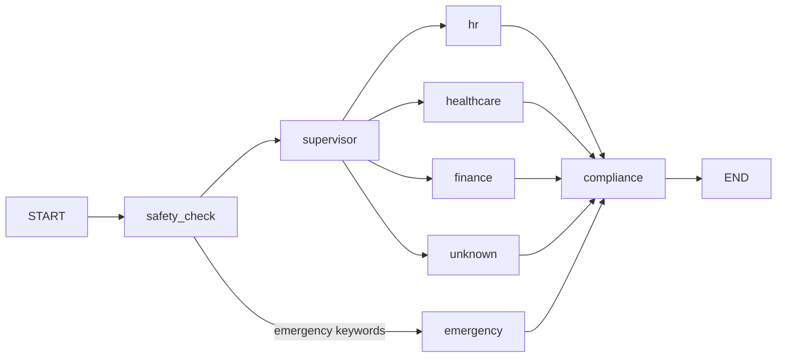

# 04 · Vertical Assistants: HR, Healthcare, Finance

One chat interface, three domain-specific assistants. A supervisor routes every message to the right domain agent; each agent has its own tools, prompt and rules. Safety and compliance are handled by dedicated graph nodes, not left to the LLM.

| Domain | Tools | Domain rules |
|--------|-------|--------------|
| **HR** (Acme Corp) | `get_employee`, `search_hr_policy`, `request_leave`, `my_leave_requests` | Leave checks balance, pending requests, working days and the 3-day-notice rule in code |
| **Healthcare** (CityCare Clinic) | `find_doctors`, `check_availability`, `book_appointment`, `my_appointments`, `cancel_appointment` | No diagnosis; emergency messages bypass the LLM; double-booking blocked by a unique index |
| **Finance** (ShopEase Pay) | `get_account_summary`, `recent_transactions`, `spending_by_category` | Read-only; every call verifies account number + owner email; no investment advice |

## Graph



- `safety_check`: regex for emergencies ("chest pain", "can't breathe", ...) → immediate 112 guidance, no LLM.
- `supervisor`: structured-output router (`hr | healthcare | finance | unknown`) with a keyword fallback; it knows the previous domain, so follow-ups like "yes, book it" stay in the same domain.
- `compliance`: appends the healthcare / finance disclaimer in code.
- Memory: `InMemorySaver` checkpointer + `add_messages`; each CLI session is one thread.

## Run

```bash
cd 04_vertical_assistants
python main.py
```

## Try these

```
# HR
How many days of annual leave do I get?
What's my leave balance? I'm E101
Apply leave for E103 from <a date next month> to <3 days later> for a family function

# Healthcare
I have a skin rash, which doctor should I see?
Is Dr. Sara Thomas free next Tuesday?
Book that 11:30 slot for Anita Roy, anita@example.com, reason skin rash
I have severe chest pain                   -> emergency response

# Finance
What's the balance on ACC-5001? Email rahul@example.com
How much did I spend by category in September 2026?
Show my last 5 transactions
```

## API

```bash
uvicorn api:app --port 8004      # docs: http://127.0.0.1:8004/docs
```

| Method | Path | Body | Returns |
|--------|------|------|---------|
| POST | `/chat` | `{"message": "...", "thread_id": "optional"}` | `thread_id`, `domain`, `reply` |
| GET | `/threads/{thread_id}` | | Conversation so far and current domain |
| GET | `/health` | | `{"status": "ok"}` |

Reuse the `thread_id` for follow-ups such as "yes, book it". Threads are kept in memory, so they reset when the server restarts.

## What to learn from it

- The **supervisor pattern** with specialised sub-agents.
- Using a checkpointer so multi-turn context survives between `invoke` calls.
- Pre- and post-processing nodes for safety and regulatory text.
- Putting business rules (balances, schedules, ownership) in tools, not prompts.
